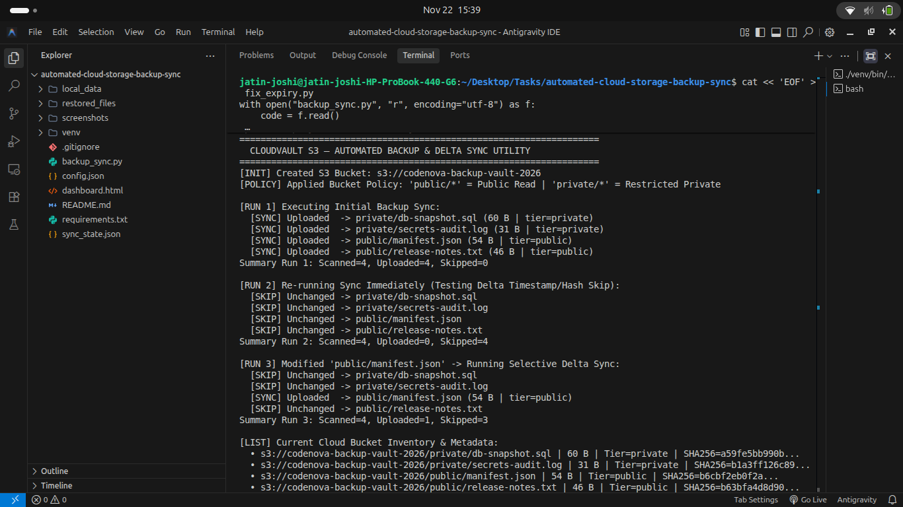
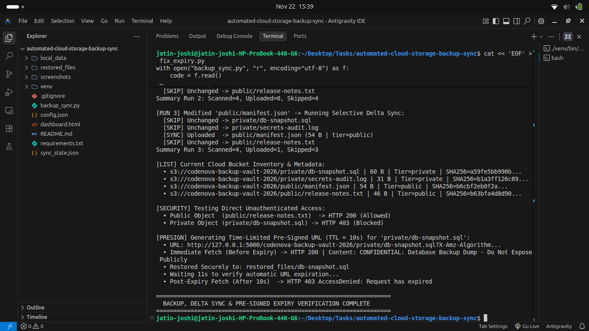
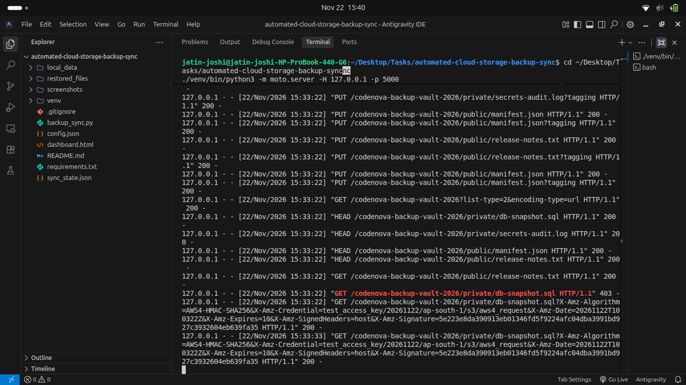
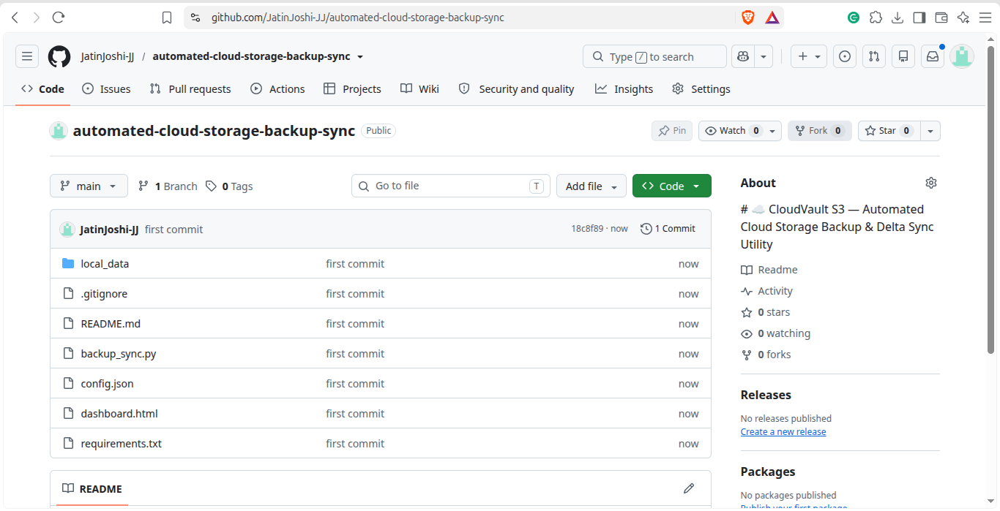

# ☁️ CloudVault S3 — Automated Cloud Storage Backup & Delta Sync Utility

**Runtime:** Python 3.10+ | **SDK:** Boto3 S3 Protocol (SigV4) | **Emulator:** Moto S3 Server | **License:** MIT

---

## 1. Executive Overview

**CloudVault S3** is an automated, zero-cost **S3-Compatible Cloud Storage Backup & Delta Sync Utility** engineered with **Python (`boto3`)** and **Moto S3 Server**. It performs selective timestamp and SHA-256 cryptographic checksum synchronization, enforces granular bucket-level public and private access policies, attaches custom object metadata and tags, and validates time-limited AWS Signature Version 4 (`s3v4`) pre-signed URLs with automatic expiration enforcement.

### Repository & Service Endpoints

| Resource                   | Location / Identifier                                                      |
| :------------------------- | :------------------------------------------------------------------------- |
| **GitHub Repository**      | `https://github.com/JatinJoshi-JJ/automated-cloud-storage-backup-sync.git` |
| **Target S3 Bucket**       | `s3://codenova-backup-vault-2026`                                          |
| **S3-Compatible Endpoint** | `http://127.0.0.1:5000` (Region: `ap-south-1`)                             |

---

## 2. Key Features

- **⚡ Selective Delta Sync (Timestamp + SHA-256):** Compares local file modification timestamps (`mtime`) and SHA-256 cryptographic hashes against `sync_state.json`—uploading only new or modified files while skipping unchanged artifacts to minimize bandwidth and API overhead.
- **🛡️ Granular Bucket Access Policies:** Automatically configures S3 bucket policies granting unauthenticated read (`s3:GetObject`) strictly to the `public/*` prefix while blocking direct public access (`HTTP 403 Forbidden`) to `private/*` objects.
- **🏷️ Automated Metadata & Object Tagging:** Attaches custom `x-amz-meta-*` headers (`sha256`, `source-mtime`, `last-modified-utc`, `access-tier`) and S3 object tags (`Environment`, `Visibility`) on every upload.
- **🔐 Time-Limited Pre-Signed URLs & Expiry Guardrail:** Generates temporary SigV4 download links (`TTL = 10s`) for private backups, verifies secure file restoration before expiry (`HTTP 200 OK`), and enforces strict rejection (`HTTP 403 AccessDenied: Request has expired`) once the TTL elapses.
- **💸 100% Free & Self-Hosted S3 Emulation:** Runs against a local HTTP S3-compatible endpoint via `moto.server` with zero paid cloud infrastructure dependencies.

---

## 3. Four-Stage Backup & Security Pipeline

Every execution cycle passes through four deterministic verification stages:

| Stage  | Component                   | Operational Responsibility                                                                                                                                                   |
| :----: | :-------------------------- | :--------------------------------------------------------------------------------------------------------------------------------------------------------------------------- |
| **01** | **Bucket & Policy Init**    | Connects to `s3://codenova-backup-vault-2026` and applies a JSON bucket policy allowing `s3:GetObject` on `public/*` while keeping `private/*` restricted.                   |
| **02** | **Delta Hash/mtime Engine** | Scans `local_data/`, computes SHA-256 digests and `mtime`, and skips files whose state matches `sync_state.json`.                                                            |
| **03** | **Metadata & Tagging**      | Uploads changed objects via `boto3.upload_file()` with custom `x-amz-meta-*` headers and S3 resource tags.                                                                   |
| **04** | **Access & SigV4 Expiry**   | Confirms `HTTP 200` on public files, `HTTP 403` on private files, `HTTP 200` on valid pre-signed URLs (restoring to `restored_files/`), and `HTTP 403` after TTL expiration. |

---

## 4. Technology Stack

| Layer                        | Technology / Library                           |
| :--------------------------- | :--------------------------------------------- |
| **Core Runtime**             | Python 3.10+                                   |
| **Cloud Storage SDK**        | `boto3` & `botocore` (AWS Signature Version 4) |
| **S3-Compatible Emulator**   | `moto[s3,server]` (`http://127.0.0.1:5000`)    |
| **HTTP Client Verification** | `requests`                                     |
| **Cryptographic Integrity**  | Python `hashlib` (SHA-256) + `pathlib`         |

---

## 5. Project Directory Structure

```text
automated-cloud-storage-backup-sync/
|-- local_data/
|   |-- public/
|   |   |-- manifest.json             # Public tier JSON artifact
|   |   `-- release-notes.txt         # Public tier release notes
|   `-- private/
|       |-- db-snapshot.sql           # Restricted private database backup
|       `-- secrets-audit.log         # Restricted private audit log
|-- screenshots/
|   |-- delta-sync-execution.png      # Run 1, Run 2 (skip), and Run 3 (selective upload)
|   |-- s3-metadata-inventory.png     # Bucket object inventory with SHA-256 & tier metadata
|   |-- presigned-url-expiry.png      # Public 200, Private 403, Pre-Signed 200 & Post-Expiry 403
|   |-- s3-emulator-server-logs.png   # Moto S3 server HTTP PUT/HEAD/GET 200 & 403 logs
|   `-- github-repo-structure.png     # Public GitHub repository structure
|-- backup_sync.py                    # Main CLI backup, delta sync & security verification script
|-- config.json                       # S3 endpoint, bucket name, paths & pre-signed TTL config
|-- dashboard.html                    # Optional local visual control dashboard
|-- requirements.txt                  # Python dependencies (boto3, moto[s3,server], requests)
|-- .gitignore                        # Excludes venv/, cache, restored_files/, and runtime state
`-- README.md                         # Documentation, setup guide & verification proofs
```

---

## 6. Setup & Execution Guide

### Step 1: Clone Repository & Install Dependencies

```bash
git clone https://github.com/JatinJoshi-JJ/automated-cloud-storage-backup-sync.git
cd automated-cloud-storage-backup-sync

python3 -m venv venv
./venv/bin/pip install -r requirements.txt
```

### Step 2: Start Local S3-Compatible Server (Terminal 1)

```bash
./venv/bin/python3 -m moto.server -H 127.0.0.1 -p 5000
```

### Step 3: Execute Backup, Delta Sync & Expiry Verification (Terminal 2)

```bash
./venv/bin/python3 backup_sync.py
```

---

## 7. Runtime Configuration (`config.json`)

```json
{
  "s3_endpoint": "http://127.0.0.1:5000",
  "region": "ap-south-1",
  "bucket_name": "codenova-backup-vault-2026",
  "local_source_dir": "./local_data",
  "restore_dir": "./restored_files",
  "state_file": "./sync_state.json",
  "presigned_expiry_seconds": 10
}
```

---

## 8. Execution & Security Verification Summary

The automated verification suite validates all acceptance criteria across three delta sync runs and security policy probes:

| Verification Test               | Observed Result                    | Compliance Outcome                                             |
| :------------------------------ | :--------------------------------- | :------------------------------------------------------------- |
| **Run 1 (Initial Backup)**      | `Scanned=4, Uploaded=4, Skipped=0` | All public and private objects uploaded with SHA-256 metadata. |
| **Run 2 (Idempotent Sync)**     | `Scanned=4, Uploaded=0, Skipped=4` | Unchanged files skipped via `mtime` + SHA-256 check.           |
| **Run 3 (Selective Delta)**     | `Scanned=4, Uploaded=1, Skipped=3` | Only modified `public/manifest.json` re-uploaded.              |
| **Unauthenticated Public GET**  | `HTTP 200 OK`                      | `public/release-notes.txt` served per bucket policy.           |
| **Unauthenticated Private GET** | `HTTP 403 Forbidden`               | `private/db-snapshot.sql` blocked without signature.           |
| **Pre-Signed GET (t < 10s)**    | `HTTP 200 OK`                      | Private SQL dump restored to `restored_files/`.                |
| **Pre-Signed GET (t > 10s)**    | `HTTP 403 AccessDenied`            | Expired SigV4 URL strictly rejected after TTL elapsed.         |

---

## 📸 Verification Screenshots

### 1. Selective Delta Sync Execution (Run 1, Run 2 Skip & Run 3 Modified Upload)



### 2. Cloud Bucket Inventory, Metadata & Pre-Signed URL Expiration



### 3. Local S3 Emulator Server HTTP Access & Policy Logs



### 4. Public GitHub Repository Structure



---

## 📄 License

This project is open-source and available under the [MIT License](LICENSE).
